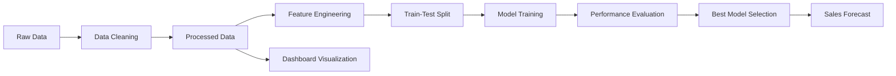

# 🛒 E-Commerce Sales Analysis and Forecasting System

A comprehensive Python-based system for analyzing e-commerce sales data and forecasting future trends using machine learning models. This project includes data cleaning, exploratory data analysis (EDA), multiple forecasting models, and an interactive Streamlit dashboard.

---

## 📋 Table of Contents

- [Overview](#overview)
- [Features](#features)
- [Project Structure](#project-structure)
- [Installation](#installation)
- [Usage](#usage)
  - [Data Cleaning](#data-cleaning)
  - [Model Training & Forecasting](#model-training--forecasting)
  - [Dashboard](#dashboard)
- [Technologies Used](#technologies-used)
- [Models & Algorithms](#models--algorithms)
- [Dataset Requirements](#dataset-requirements)
- [Results & Metrics](#results--metrics)
- [Contributing](#contributing)
- [License](#license)

---

## 🎯 Overview

This system provides end-to-end e-commerce sales analysis and forecasting capabilities:

1. **Data Processing**: Clean and prepare raw sales data
2. **Analysis**: Perform exploratory data analysis with visualizations
3. **Modeling**: Train multiple machine learning models for sales forecasting
4. **Visualization**: Interactive dashboard for insights and metrics
5. **Forecasting**: Predict future sales trends based on historical data

The system is designed to help businesses understand sales patterns, identify top-performing regions and categories, and make data-driven decisions.

---

## ✨ Features

- **Data Cleaning Pipeline**: Automatic handling of duplicates, missing values, and data type conversions
- **Feature Engineering**: Time-based features (Year, Month) and encoded categorical variables
- **Multiple ML Models**: Linear Regression and Random Forest Regressor for comparison
- **Performance Metrics**: MAE, RMSE, and R² score for model evaluation
- **Interactive Dashboard**: Streamlit-based UI with KPIs and visualizations
- **Time-Based Split**: Proper temporal train-test split (80-20) for time series data
- **Comprehensive Visualization**: Sales trends, regional analysis, category breakdown, and correlation analysis

---

## 📁 Project Structure

```
Ecommerce-Sales-Analysis-and-Forecasting-System/
│
├── data/
│   ├── sales_data_cleaned.csv          # Raw cleaned data
│   └── sales_data_processed.csv        # Processed data ready for modeling
│
├── src/
│   ├── data_cleaning.py                # Data cleaning and preprocessing
│   ├── eda.py                          # Exploratory data analysis
│   ├── forcasting.py                   # Model training and forecasting
│   └── visualization.py                # Visualization utilities
│
├── dashboard/
│   └── app.py                          # Streamlit dashboard application
│
├── output/                             # Directory for output files and results
│
├── requirements.txt                    # Python dependencies
├── config.py                           # Configuration settings
└── README.md                           # This file
```

---

## 🚀 Installation

### Prerequisites
- Python 3.8 or higher
- pip (Python package manager)

### Setup

1. **Clone the repository**
   ```bash
   git clone https://github.com/Sanskar-novadule/Ecommerce-Sales-Analysis-and-Forecasting-System.git
   cd Ecommerce-Sales-Analysis-and-Forecasting-System
   ```

2. **Create a virtual environment** (recommended)
   ```bash
   python -m venv venv
   source venv/bin/activate  # On Windows: venv\Scripts\activate
   ```

3. **Install dependencies**
   ```bash
   pip install -r requirements.txt
   ```

---

## 📖 Usage

### Data Cleaning

Prepare and clean your raw sales data:

```bash
python src/data_cleaning.py
```

**What it does:**
- Loads raw sales data from `data/sales_data_cleaned.csv`
- Removes duplicate rows
- Checks for missing values
- Converts date columns to datetime format
- Creates temporal features (Year, Month_Number)
- Validates total sales calculations
- Saves processed data to `data/sales_data_processed.csv`

**Expected Output:**
```
Original shape: (n_rows, n_cols)
Duplicate rows: 0
Shape after removing duplicates: (n_rows, n_cols)
Final data saved to: data/sales_data_processed.csv
```

### Model Training & Forecasting

Train machine learning models and generate forecasts:

```bash
python src/forcasting.py
```

**What it does:**
- Loads processed data
- Performs feature engineering:
  - Extracts Year and Month from date
  - One-hot encodes Region and Category
  - Normalizes numerical features
- Splits data into training (80%) and testing (20%) sets using time-based split
- Trains two models:
  - **Linear Regression**: Simple linear relationships
  - **Random Forest Regressor**: Complex non-linear patterns
- Generates predictions on test set
- Calculates performance metrics (MAE, RMSE, R²)
- Identifies the best-performing model

**Expected Output:**
```
================ MODEL PERFORMANCE ================

Linear Regression
-------------------------
MAE  : 1234.56
RMSE : 2345.67
R²   : 0.8234

Random Forest
-------------------------
MAE  : 890.12
RMSE : 1567.89
R²   : 0.9156

================ MODEL PERFORMANCE % ================
Linear Regression Performance: 82.34%
Random Forest Performance: 91.56%

Best Model: Random Forest Regressor
```

### Dashboard

Launch the interactive Streamlit dashboard:

```bash
streamlit run dashboard/app.py
```

**Dashboard Features:**
- 📊 **KPI Cards**: Total Revenue, Total Orders, Top Region, Top Category
- 📈 **Sales by Region**: Bar chart showing regional performance
- 📅 **Monthly Sales Trend**: Line chart displaying sales over time
- 🍰 **Category Distribution**: Pie chart showing category-wise sales
- 🔗 **Correlation Heatmap**: Relationships between numerical features
- 📋 **Data Table**: Complete dataset view with filtering and sorting

**Access the dashboard:**
- Open your browser and navigate to `http://localhost:8501`

---

## 🛠 Technologies Used

### Core Libraries
- **pandas**: Data manipulation and analysis
- **numpy**: Numerical computations
- **scikit-learn**: Machine learning models and preprocessing
  - LinearRegression
  - RandomForestRegressor
  - OneHotEncoder
  - Model evaluation metrics (MAE, RMSE, R²)

### Visualization
- **matplotlib**: Static plotting and figure creation
- **seaborn**: Statistical data visualization
- **plotly** (via streamlit): Interactive visualizations

### Web Framework
- **streamlit**: Interactive web application framework

### Data Processing
- **scipy**: Scientific computing
- **joblib**: Serialization and parallel processing

### Additional
- **python-dateutil**: Date utilities
- **requests**: HTTP library
- **pyarrow**: Data serialization

---

## 🤖 Models & Algorithms

### 1. Linear Regression
- **Type**: Simple regression model
- **Best For**: Understanding linear relationships between features and sales
- **Pros**: Fast, interpretable, good baseline
- **Cons**: Assumes linear relationships

### 2. Random Forest Regressor
- **Type**: Ensemble method with 100 decision trees
- **Best For**: Capturing complex, non-linear patterns
- **Pros**: High accuracy, handles feature interactions
- **Cons**: Slower training, less interpretable

### Feature Engineering
- **Temporal Features**: Year and Month extracted from dates
- **Categorical Encoding**: One-hot encoding for Region and Category
- **Normalization**: Built-in with scikit-learn models

### Train-Test Split
- **Strategy**: Time-based split (80-20)
- **Reasoning**: Respects temporal order for time-series data
- **Implementation**: First 80% as training, last 20% as testing

---

## 📊 Dataset Requirements

Your input CSV file (`data/sales_data_cleaned.csv`) should contain:

| Column | Type | Description |
|--------|------|-------------|
| Month | Date | Transaction date (YYYY-MM-DD format) |
| Region | Categorical | Geographic region (e.g., North, South, East, West) |
| Category | Categorical | Product category (e.g., Electronics, Clothing, etc.) |
| Quantity | Numerical | Number of units sold |
| Price | Numerical | Price per unit |
| TotalSales | Numerical | Total sales amount (Quantity × Price) |

**Example:**
```
Month,Region,Category,Quantity,Price,TotalSales
2023-01-01,North,Electronics,5,1200,6000
2023-01-02,South,Clothing,10,500,5000
```

---

## 📈 Results & Metrics

### Model Performance Metrics

**Mean Absolute Error (MAE)**
- Measures average absolute prediction error
- Lower values indicate better performance

**Root Mean Squared Error (RMSE)**
- Penalizes larger errors more heavily
- In the same units as the target variable

**R² Score (Coefficient of Determination)**
- Represents proportion of variance explained
- Range: 0 to 1 (higher is better)
- 0.8+ indicates good model fit

### Typical Performance
- **Random Forest** generally outperforms Linear Regression on this dataset
- Performance depends on data quality and feature relevance
- Monitor metrics to identify overfitting or underfitting

---

## 📝 Sample Output

After running the forecasting model, you'll see:

```
Dataset Shape: (240, 6)

================ TRAIN / TEST SPLIT ================
Training X: (192, 18)
Testing X : (48, 18)
Training y: (192,)
Testing y : (48,)

Last Training Month: 2023-12-31
First Testing Month: 2024-01-01

================ PREDICTIONS ================
Linear Regression Predictions:
[5234.5 6123.4 5890.2 ...]

Random Forest Predictions:
[5201.3 6145.7 5923.1 ...]

Actual TotalSales:
[5200 6150 5920 ...]

================ MODEL PERFORMANCE ================
Linear Regression: R² = 0.8234 (82.34%)
Random Forest: R² = 0.9156 (91.56%)

Best Model: Random Forest Regressor
```

---

## 🎨 Dashboard Screenshots

The Streamlit dashboard provides:
- **KPI Summary Cards** at the top
- **Sales Analysis Charts** (Region, Monthly Trend, Category)
- **Correlation Heatmap** for feature relationships
- **Full Dataset Table** for detailed exploration
- **Responsive Layout** that adapts to screen size

---

## 🚦 Workflow Example



---

## 🔧 Configuration

Edit `config.py` to customize:
- File paths
- Model parameters
- Train-test split ratio
- Feature selection

---

## 🤝 Contributing

Contributions are welcome! Please:
1. Fork the repository
2. Create a feature branch (`git checkout -b feature/YourFeature`)
3. Commit changes (`git commit -m 'Add YourFeature'`)
4. Push to branch (`git push origin feature/YourFeature`)
5. Open a Pull Request

---

## 📄 License

This project is open-source and available under the MIT License.

---

## 📧 Contact & Support

For questions or issues:
- Open an issue in the GitHub repository
- Contact: [Your Email/Contact Info]

---

## 🎓 Educational Purpose

This project demonstrates:
- Data cleaning and preprocessing pipelines
- Exploratory data analysis techniques
- Machine learning model implementation and comparison
- Time-series data handling
- Interactive web application development with Streamlit
- Best practices in data science workflows

---

## 🗺️ Roadmap

Future enhancements:
- [ ] Advanced time-series models (ARIMA, Prophet)
- [ ] Seasonal decomposition analysis
- [ ] Feature importance visualization
- [ ] Model persistence and deployment
- [ ] Real-time data updates
- [ ] Automated report generation
- [ ] Multi-step ahead forecasting
- [ ] Integration with live data sources

---

**Last Updated**: August 2026  
**Version**: 1.0.0


